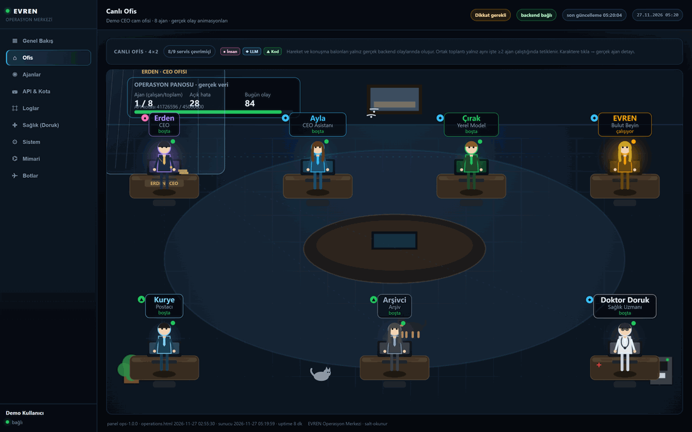
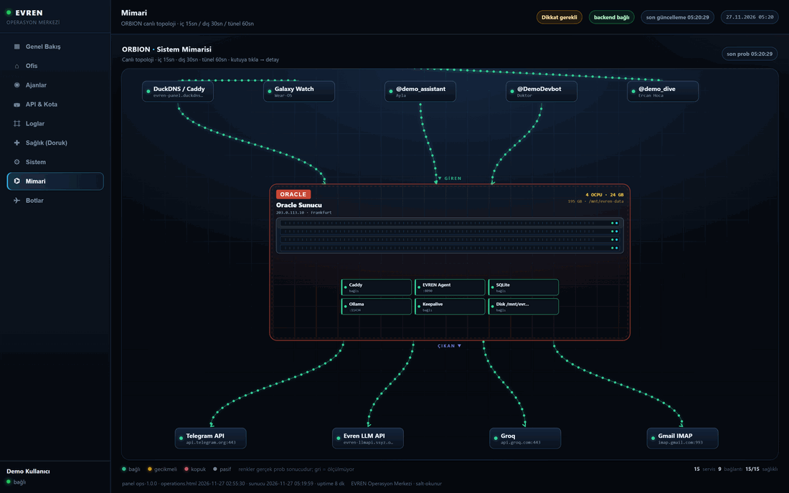
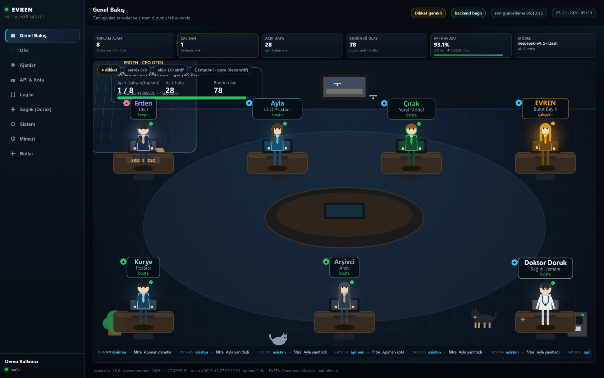
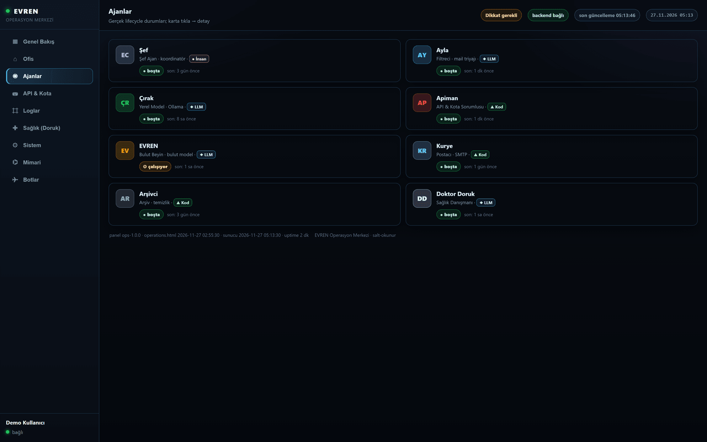
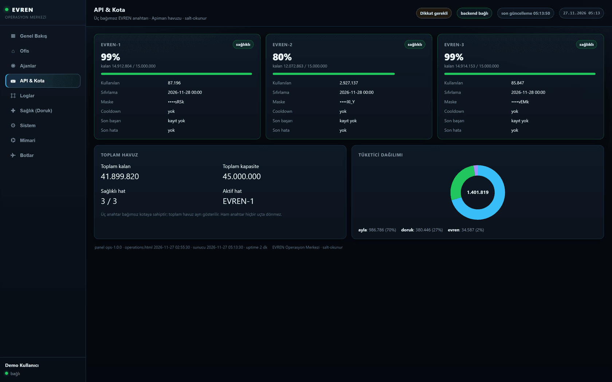
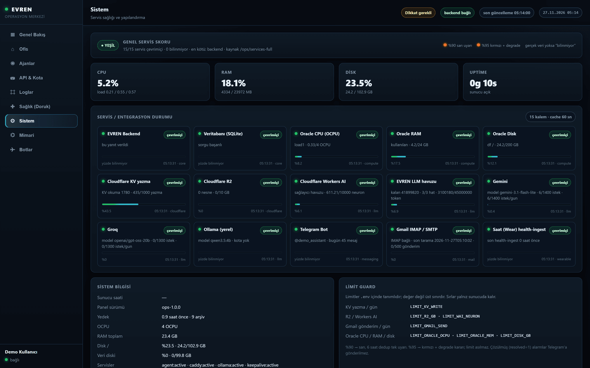
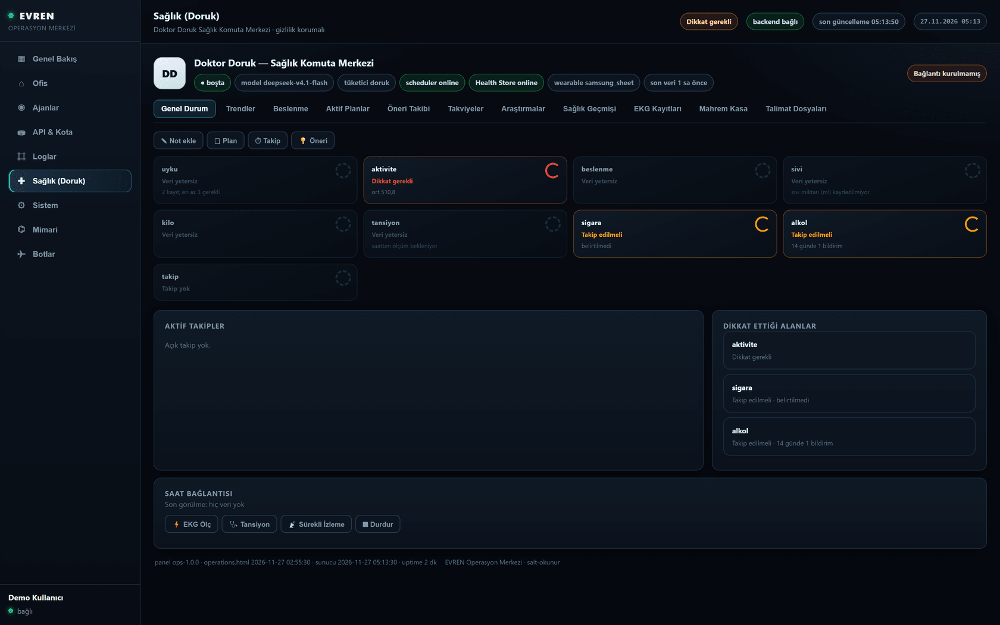
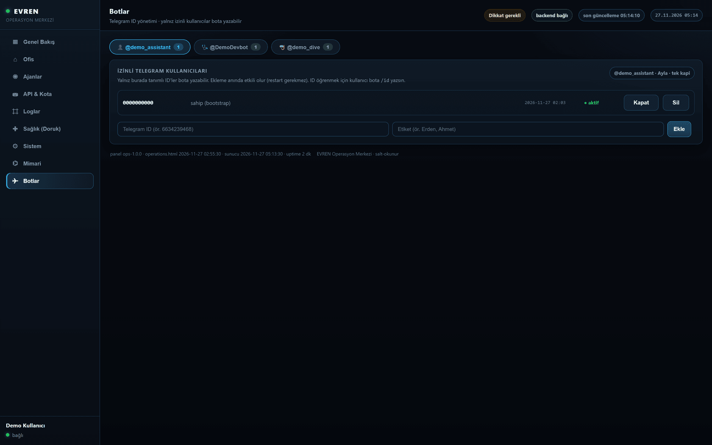

<div align="center">

# 🛰️ ORBION

**A self-hosted, multi-agent AI office.**
Zero cloud lock-in · modular LLM providers · your data stays on your box.

[](https://evren-demo.erdenyagici.workers.dev/operations.html)
[](LICENSE)


*English · [Türkçe](README.tr.md)*

</div>

---

> **Try it live:** <https://evren-demo.erdenyagici.workers.dev/operations.html> — password `123456`
> A read-only instance with **synthetic data**. Every write endpoint is blocked server-side (`403`).

---

## What is ORBION?

ORBION turns a single small server (a free-tier VM is enough) into a **personal AI office**:
a coordinator agent that delegates work to specialists, a live web console, a Telegram
interface, and a **Wear OS bridge** that streams health telemetry in real time.

It runs on ~$0/month: Oracle Cloud free tier, no GPU, no vendor lock-in, no per-token anxiety.

<div align="center">

### Live office — real agent activity, not a canned animation


### Live architecture — every link is probed, green/amber/red


</div>

---

## Screenshots

| | |
|---|---|
| <br/><sub><b>Overview</b> — agents, services, KPIs at a glance</sub> | <br/><sub><b>Agents</b> — real lifecycle states</sub> |
| <br/><sub><b>API & quota</b> — masked keys, live usage, failover state</sub> | <br/><sub><b>System</b> — CPU / RAM / disk / services</sub> |
| <br/><sub><b>Health</b> — isolated, doctor-owned view (demo data)</sub> | <br/><sub><b>Bot management</b> — per-bot Telegram allowlist</sub> |

<sub>Static vector architecture map: [`assets/showcase/mimari-final.svg`](assets/showcase/mimari-final.svg)</sub>

---

## Architecture

```
        Clients / bots                          External services
 ┌──────────┬──────────┬──────────┐      ┌──────────┬──────────┬──────────┐
 │ Browser  │  Watch   │ Telegram │      │ LLM APIs │  Groq    │  Gmail   │
 └────┬─────┴────┬─────┴────┬─────┘      └────┬─────┴────┬─────┴────┬─────┘
      │ HTTPS    │ POST     │ bot API         │          │          │
      ▼          ▼          ▼                 ▲          ▲          ▲
 ┌────────────────────────────────────────────┴──────────┴──────────┴───┐
 │                     ORACLE CLOUD VM  (free tier, ARM)                 │
 │  ┌─────────┐  ┌──────────────┐  ┌──────────┐  ┌─────────┐  ┌───────┐ │
 │  │  Caddy  │→ │ evren-agent  │  │  SQLite  │  │ Ollama  │  │ disk  │ │
 │  │  (TLS)  │  │  :8090 HTTP  │  │ app.db   │  │ local   │  │backups│ │
 │  └─────────┘  └──────────────┘  └──────────┘  └─────────┘  └───────┘ │
 └───────────────────────────────────────────────────────────────────────┘
```

**Request path:** Caddy terminates TLS → reverse-proxies to `127.0.0.1:8090` → the agent
serves the panel, the JSON API, and the health ingest endpoint.

---

## Why it's different

| | Typical AI assistant | **ORBION** |
|---|---|---|
| Where it runs | Vendor cloud | **Your server** |
| AI vendor | Locked to one | **Hot-swappable pool** (Gemini → Groq → Cloudflare → local Ollama) |
| Cost | Per-token billing | **Free tiers + local fallback** |
| Proof of work | "I did it" | **`call_id` + status for every agent call** |
| Data | Uploaded to someone | **Stays on your box** |
| Presence | A chat window | **Live office, watch face, Telegram** |

---

## Features

- **Multi-agent orchestration** — a coordinator delegates to specialists (assistant,
  coder, mail archivist, researcher). Every call is logged with `call_id`, status and
  duration, so *"I did it"* is always backed by evidence.
- **Provider-agnostic LLM pool** — OpenAI-compatible adapters with automatic failover.
  When a provider is down or out of quota, ORBION moves to the next. No single point of failure.
- **Zero-cost first** — deterministic code handles everything it can (no LLM call for
  classification, routing, counting). The LLM is a *last resort*, not the default.
- **Telegram interface** — natural conversation, plus a separate channel per agent,
  with per-bot user-ID allowlists managed from the panel.
- **Live web console** — real-time office view, per-service health, one-screen ops dashboard,
  and a **live topology** map where every link is probed and color-coded.
- **Wear OS bridge** — battery-first health telemetry: short-lived wake locks, 10-minute
  polling, opt-in sensors, device-side timestamps, idempotent batches.
- **Safety by design** — never fabricates citations, never claims an action it didn't take,
  escalates honestly when a tool is unavailable.

---

## Architecture highlights

- **Single-process core, thread-isolated agents** — cheap to run on 2–4 vCPU.
- **SQLite with a strict evidence model** — `agent_calls`, `agent_tasks`, `agent_events`;
  every delegated task is traceable end-to-end.
- **Atomic job queue** — `claim / heartbeat / reclaim` with timeouts; a crashed worker
  never silently loses a job.
- **Fail-closed security** — missing tokens disable protected endpoints rather than opening
  them; scoped session tokens; no secrets in logs; no wildcard CORS.
- **Prompt-injection & SSRF aware** — external fetches reject private/loopback ranges.

---

## Security model

| Layer | Measure |
|---|---|
| Panel auth | Password → short-lived signed session token (never returns the master token) |
| Scopes | `master` / `doctor` / `viewer` — enforced server-side, fail-closed |
| Bots | Per-bot Telegram user-ID allowlist stored in the DB, hot-reloaded without restart |
| Secrets | `.env` only, `chmod 600`, never in code or logs |
| Health ingest | Separate token, separate endpoint, count-only responses |
| Logging | Bearer tokens, passwords, ID numbers, IBANs redacted before storage |

---

## Quick start

```bash
git clone https://github.com/erdenyagici-cmd/ORBION.git
cd ORBION
cp .env.example .env            # add your provider keys
python3 -m venv .venv && . .venv/bin/activate
pip install -r requirements.txt
python3 scripts/agent.py        # serves the panel on :8090
```

Open `http://localhost:8090/operations.html`, sign in with `PANEL_PASSWORD`.

---

<div align="center">

<sub><i>Your AI should be yours.</i> 📡</sub>

</div>
